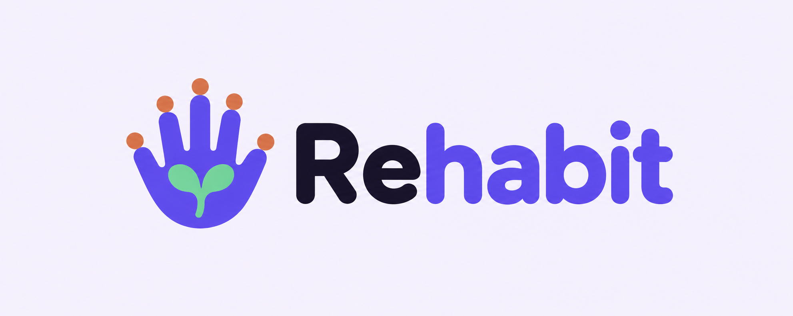
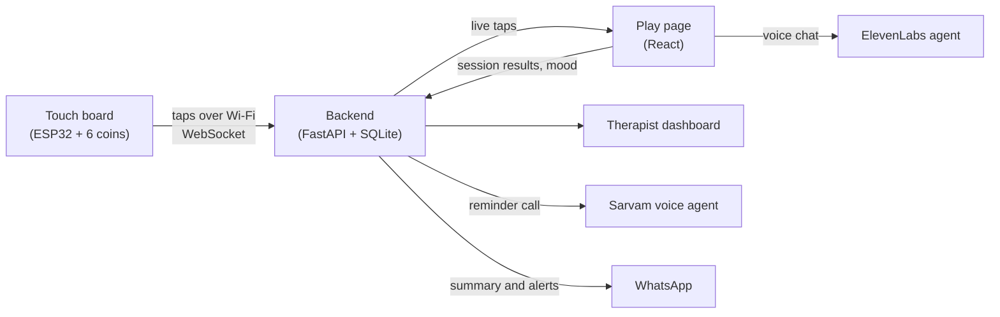

<p align="center">
  
</p>

<p align="center"><b>Recovery is a habit. We make it stick.</b></p>

<p align="center">
A low-cost touch board and web app that turn daily hand rehab for stroke survivors into short, guided games,
with an AI voice companion and updates for the family.
</p>

---

## Why

Stroke survivors need to do hand exercises every day at home, but many stop once no therapist is around. About 1 in 3 stroke survivors also lives with depression, which is linked to poorer recovery. Most rehab game systems need special hardware such as hand controllers or motion sensors.

Rehabit uses a cardboard board with six coins and an ESP32, for about ₹1,000 in parts. The patient taps the coins, and the web app turns each tap into a game, encouragement, and progress the therapist and family can see.

## Features

- **Four rehab games**
  - **Classic**: tap the coin that glows, 20 taps.
  - **Finger isolation**: fingertips only.
  - **Memory**: repeat a growing sequence.
  - **Endurance**: as many correct taps as possible in 60 seconds.
- **Live feedback**: a timer counts each reaction in milliseconds while a coin glows, and a soft chime plays on a correct tap.
- **Left or right hand**: every tap carries the hand in use. Our demo board is a left hand.
- **Voice coach and mascot**: Ankur, a sprout in a clay pot, cheers the patient on with short Hinglish voice lines.
- **AI companion (Yash)**: holding the palm coin for 2 seconds, or tapping Ankur on the menu, starts a short voice chat in Hindi about how the patient feels. The patient then rates their mood by tapping a coin from 1 to 5.
- **Reminder call (Ishu)**: an AI phone call reminds the patient a few minutes before the daily session.
- **Family updates**: a daily summary, plus alerts for a missed session or a low mood.
- **Therapist dashboard**: progress per game, mood vs reaction time, and full session history.

## How it works



Each touch on the board is sent as a small JSON message:

```json
{"type": "tap", "pad": 3, "hand": "right", "ms": 123456}
```

Holding the palm coin for 2 seconds sends `"type": "hold"`, which starts the companion from the menu.

## Hardware

| Part | Details |
| --- | --- |
| Microcontroller | ESP32-DevKitC-32E |
| Touch pads | 6 coins on cardboard with a hand outline, read by the ESP32's capacitive touch pins |
| Hand select | GPIO 25: LOW is left, HIGH is right. A slide switch, or a wire to GND for a left-hand board |
| Power | USB from a laptop or power bank |
| Cost | About ₹1,000 per board |

| Pad | Thumb | Index | Middle | Ring | Little | Palm |
| --- | --- | --- | --- | --- | --- | --- |
| GPIO | 4 | 13 | 14 | 27 | 32 | 33 |

The firmware calibrates every pad at boot, sends one message per touch with a 150 ms debounce, and reconnects to the backend on its own if Wi-Fi or the server drops.

## Tech stack

| Layer | Tools |
| --- | --- |
| Firmware | PlatformIO, Arduino framework, WebSockets, ArduinoJson |
| Backend | Python, FastAPI, SQLite |
| Frontend | React, TypeScript, Vite, Tailwind CSS |
| Voice | ElevenLabs (coach clips and the Yash companion), Sarvam (Ishu reminder call) |

## Getting started

You need Python 3.12+, Node.js, and [PlatformIO](https://platformio.org/) for the firmware.

**1. Keys.** Copy `.env.example` to `.env` in the repo root and fill it in. Never commit `.env`.

**2. Backend**

```bash
cd backend
pip install -r requirements.txt
uvicorn main:app --reload --host 0.0.0.0 --port 8000
```

`--host 0.0.0.0` lets the board reach the backend over the local network.

**3. Frontend**

```bash
cd frontend
npm install
npm run dev
```

Open <http://localhost:5173> to play and <http://localhost:5173/dashboard> for the therapist view.

**4. Board**

1. Copy `firmware/include/secrets.example.h` to `secrets.h`. Fill in the Wi-Fi name and password (2.4 GHz), the laptop's IP address, and the same `DEVICE_TOKEN` as in `.env`.
2. Flash and watch the log:

   ```bash
   cd firmware
   pio run -t upload
   pio device monitor
   ```

   If the upload stops at "Connecting...", hold the BOOT button on the board.

**No board?** Keys 1 to 6 on the keyboard act as the pads, and holding 6 for 2 seconds acts as a palm hold. You can also run `python fake_device.py` in `backend/` to send taps over the same WebSocket as the real board.

## Project structure

```
rehabit/
├── firmware/    ESP32 firmware (PlatformIO)
├── backend/     FastAPI app: device and game sockets, REST API, scheduler
├── frontend/    React app
│   └── src/
│       ├── patient/     Play page: games, talk, mood
│       ├── therapist/   Dashboard
│       └── shared/      Device socket, API calls, shared UI
└── design/      Mockups, hand drawing, mascot and logo sources
```

## Note

Rehabit is built for tracking and motivation. It is not a medical device and does not diagnose or treat any condition.
